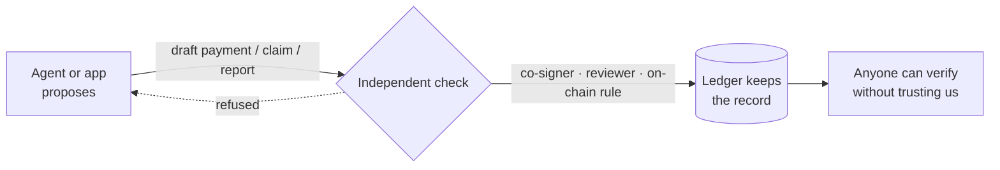

<picture>
  <source media="(prefers-color-scheme: dark)" srcset="https://readme-typing-svg.demolab.com?font=JetBrains+Mono&weight=600&size=22&duration=2800&pause=900&color=64FFDA&center=true&vCenter=true&width=720&lines=Backend+engineer.+AI+agents.+Blockchain.;An+agent+proposes%2C+an+independent+check+decides.;Building+for+South+African+small+business+and+civic+life.;Technical+Mentor+at+WeThinkCode_">
  
</picture>

# Chuma (Mike) Meyiswa

**Software Engineer (Backend) · AI Agents & Automation · Blockchain / Web3**

Founder at **Skhokho Labs** · Technical Mentor at **WeThinkCode_** · Soweto, Johannesburg

 

I build backend systems where software is allowed to **propose** but never to **decide alone**: an AI agent drafts the payment, the work order or the report, and an independent reviewer, co-signer or on-chain rule has the final say. Most of what I ship is for South African small businesses, schools and municipalities, on low-data phones, in the languages people actually speak.

 

## Now building

| Product | What it does | Status |
| :--- | :--- | :--- |
| **[BonaBlock](https://bonablock.vercel.app)** | Community reports on broken school infrastructure, with evidence digests anchored to Avalanche. A repair stays `repair_claimed` until an *independent* reviewer marks it `verified`; the `BonaRegistry` contract refuses a school admin who tries. Ships with [BonaBlock Verify](https://bona-verify.vercel.app), a standalone checker. | Live · Nov 2026 |
| **[Gcina](https://github.com/ChumaMike/gcina)** | An AI accounts-payable agent that pays suppliers on the XRP Ledger inside owner-set limits it cannot change. The agent initiates; a policy co-signer and XRPL's multi-sign rule decide. Fooled by a fake "new banking details" invoice? It still can't pay on its own. | Testnet · [dashboard](https://gcina.vercel.app) |
| **[Skhokho](https://skhokho.sgdataint.co.za)** | A shopfront, a till and a loyalty card in one phone for township businesses, plus the cash-flow record a lender can read. Live with real businesses in Dube, Soweto. | Live · [hackathon snapshot](https://github.com/ChumaMike/skhokho-hackathon-2026) |

 

## 2026 hackathon builds

Seven shipped entries in one year, each one deployed and demoable, not slideware.

| When | Event · Track | Build | The idea in one line |
| :--- | :--- | :--- | :--- |
| Nov 2026 | UJ BACISS Hackathon · Avalanche | [BonaBlock](https://bonablock.vercel.app) | A report is not protection. A repair claim is not verification. |
| Nov 2026 | W3Node Node Engine · Agentic Finance (Ripple/XRPL) | [Gcina](https://github.com/ChumaMike/gcina) | The agent pays; the ledger keeps. Two keys, one of them never the agent's. |
| Nov 2026 | NEMISA Digital Innovation Discothon | [Shay' iPost](https://shayipost.vercel.app) | Voice note in, three ready-to-share posts out, every tap counted. |
| Oct 2026 | HackSecure 2026 · SMME Cyber Protection | [Mgadi](https://github.com/ChumaMike/Mgadi) | The first hour after a payment-diversion scam, one step at a time. |
| Oct 2026 | FNB App of the Year · Youth entrepreneurship | [Skhokho](https://github.com/ChumaMike/skhokho-hackathon-2026) | Four-week sales forecast and a lender-readable statement from the till's own data. |
| Oct 2026 | Gauteng Youth Tech Expo · G12 Failing infrastructure | [SafeGuard SA](https://github.com/ChumaMike/SafeGuard) | "Made safe" and "fixed" are two outcomes. Track both, with a protection clock. |
| Jul 2026 | Microsoft Copilot Studio Agents Hackathon | [GridWise / G13-Agentic](https://github.com/ChumaMike/G13-Agentic) | Orchestrator, household and government agents over real energy data. |

 

## How I build

The same shape shows up in Gcina, BonaBlock and SafeGuard. Software gets to propose. Authority stays with someone or something independent.

 

## Earlier systems

| Project | Stack | What it is |
| :--- | :--- | :--- |
| [Sentinel Ledger](https://github.com/ChumaMike/sentinel-ledger) | Java Spring Boot · Python FastAPI · React | Double-entry ledger with real-time AI fraud monitoring and an admin console |
| [LinkUpGeo](https://github.com/ChumaMike/LinkUpGeo) | Flask · Twilio · PostGIS | Hyperlocal services marketplace over a low-data WhatsApp bot, with a geospatial dashboard for providers |
| [CivicNerve](https://github.com/ChumaMike/CivicNerve-agent) | Python · LLM agents | Reads citizen reports and blueprints, then drafts governed municipal work orders |
| [LegacyLazarus](https://github.com/ChumaMike/LegacyLazarus-agent) | Python · LangChain · IBM Granite | Agent that refactors and documents legacy code into clean, governed modules |
| [Chain Quest](https://github.com/ChumaMike/chain-quest) | React · Phaser 3 · Solidity · Sepolia | Web3 education RPG where beating a boss earns real CQT tokens |
| [LoadShedd](https://github.com/ChumaMike/LoadShedd) | Java · ActiveMQ · JMS | Systems-integration study: from synchronous RPC to message-driven, load-shedding-tolerant services |

 

## Stack

| Languages | Backend & data | Tooling |
| :---: | :---: | :---: |
|  |  |  |

AI & agents: LangChain · LLM tool-calling agents · Microsoft Copilot Studio · OpenAI / Anthropic / Gemini APIs  
Web3: Solidity · Avalanche (EVM) · XRP Ledger · Hardhat / viem  
Also: Drizzle · Playwright · vitest · Twilio / WhatsApp · Firebase

 

## Roles

- **Founder, Skhokho Labs** · 2026 to present. Products and client builds for South African small businesses.
- **Technical Mentor & Code Reviewer, WeThinkCode_** · Sep 2025 to present. Java and Python systems design, code review, mentoring.
- **Software Engineering Fellow, WeThinkCode_** · Sep 2024 to Dec 2025. Occupational Certificate: Software Engineer (NQF 6), Systems Integration.
- **Graphic Designer, Meyiswa Training Academy** · Jul 2022 to Jan 2024. Course material, brochures and brand collateral under deadline.
- **Africa Blockchain Club** · member in 2026, returning.

 

## Activity

<picture>
  <source media="(prefers-color-scheme: dark)" srcset="https://github-readme-stats.vercel.app/api?username=ChumaMike&show_icons=true&hide_border=true&bg_color=0a0f1e&title_color=64ffda&icon_color=4c9eff&text_color=e6f1ff&hide_title=true&rank_icon=github">
  
</picture>
<picture>
  <source media="(prefers-color-scheme: dark)" srcset="https://github-readme-stats.vercel.app/api/top-langs/?username=ChumaMike&layout=compact&hide_border=true&bg_color=0a0f1e&title_color=64ffda&text_color=e6f1ff&langs_count=6&hide=html,css">
  
</picture>

<picture>
  <source media="(prefers-color-scheme: dark)" srcset="https://raw.githubusercontent.com/ChumaMike/ChumaMike/output/github-snake.svg">
  
</picture>

Most of 2026's commits live in private product repos, so the public graph undercounts.

 

  <i>Build things that keep working when nobody is watching.</i>

